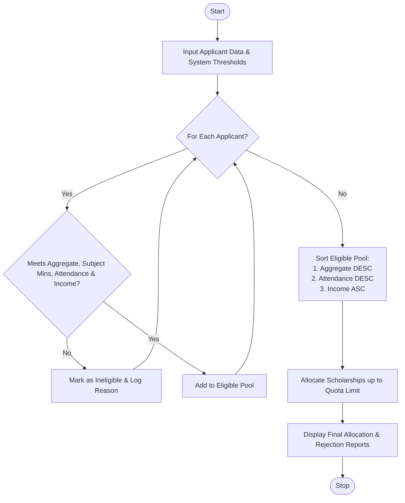

Here is a complete design and implementation for the **University Scholarship Allocation System**, covering the problem statement, algorithm, Mermaid flowchart, Python source code, and sample I/O.

---

## 1. Problem Statement

Universities receive thousands of applications for merit- and need-based scholarships, but resources and quotas are limited. The objective is to design an automated system that:

1. **Filters applicants** based on strict eligibility criteria:
* Minimum aggregate percentage (e.g., $\ge 80\%$)
* Subject-wise minimum scores (e.g., all core subjects $\ge 60\%$)
* Minimum attendance percentage (e.g., $\ge 75\%$)
* Maximum annual family income ceiling (e.g., $\le \$60,000$)


2. **Ranks eligible students** based on their academic performance.
3. **Resolves ties deterministically** using predefined criteria (higher attendance, then lower family income).
4. **Allocates scholarships** up to a predefined quota limit.

---

## 2. Algorithm

1. **Initialize:** Define system thresholds (Min Aggregate: $80$, Min Subject Score: $60$, Min Attendance: $75$, Max Income: $60000$) and scholarship quota (`MAX_SLOTS`).
2. **Read Input:** Load applicant records containing ID, name, aggregate marks, subject scores dictionary, attendance percentage, and annual income.
3. **Filter Candidates (Eligibility Check):**
* For each applicant, check if aggregate marks $\ge$ threshold.
* Check if all individual subject scores $\ge$ minimum requirement.
* Check if attendance $\ge$ minimum requirement.
* Check if annual income $\le$ maximum income limit.
* If any check fails, mark the applicant as **Rejected** with the specific reason. Otherwise, add them to the **Eligible Pool**.


4. **Rank and Sort:** Sort the eligible pool using multi-key sorting:
* Primary Key: Aggregate Marks (**Descending**)
* Secondary Key: Attendance Percentage (**Descending**)
* Tertiary Key: Annual Income (**Ascending**)


5. **Allocate Scholarships:** Iterate through the sorted eligible pool and assign scholarships up to `MAX_SLOTS`.
6. **Output Results:** Generate a final report showing allocated scholars and rejected applicants with reasons.

---

## 3. Flowchart (Mermaid)



---

## 4. Python Source Code

```python
class ScholarshipSystem:
    def __init__(self, min_aggregate, min_subject_score, min_attendance, max_income, quota):
        self.min_aggregate = min_aggregate
        self.min_subject_score = min_subject_score
        self.min_attendance = min_attendance
        self.max_income = max_income
        self.quota = quota

    def evaluate_applicants(self, applicants):
        eligible_pool = []
        rejected_pool = []

        for app in applicants:
            reasons = []
            
            # 1. Check aggregate marks
            if app["aggregate"] < self.min_aggregate:
                reasons.append(f"Aggregate marks {app['aggregate']}% below minimum {self.min_aggregate}%")
            
            # 2. Check subject-wise minimum scores
            for subject, score in app["subject_scores"].items():
                if score < self.min_subject_score:
                    reasons.append(f"Score in {subject} ({score}) below minimum {self.min_subject_score}")
            
            # 3. Check attendance
            if app["attendance"] < self.min_attendance:
                reasons.append(f"Attendance {app['attendance']}% below minimum {self.min_attendance}%")
            
            # 4. Check income criteria
            if app["income"] > self.max_income:
                reasons.append(f"Income ${app['income']} exceeds maximum limit ${self.max_income}")

            if reasons:
                app["reasons"] = "; ".join(reasons)
                rejected_pool.append(app)
            else:
                eligible_pool.append(app)

        # Sort eligible students: Aggregate (DESC), Attendance (DESC), Income (ASC)
        eligible_pool.sort(key=lambda x: (-x["aggregate"], -x["attendance"], x["income"]))

        # Allocate scholarships based on quota
        allocated_scholars = eligible_pool[:self.quota]
        waitlisted = eligible_pool[self.quota:]

        return allocated_scholars, waitlisted, rejected_pool

# --- Sample Execution ---
if __name__ == "__main__":
    system = ScholarshipSystem(
        min_aggregate=80.0,
        min_subject_score=65.0,
        min_attendance=75.0,
        max_income=50000.0,
        quota=2
    )

    applicants = [
        {
            "id": "A001", "name": "Alice Smith", "aggregate": 92.5,
            "subject_scores": {"Math": 90, "Physics": 95, "English": 88},
            "attendance": 94.0, "income": 42000.0
        },
        {
            "id": "A002", "name": "Bob Jones", "aggregate": 85.0,
            "subject_scores": {"Math": 60, "Physics": 80, "English": 85}, # Fails Math min (60 < 65)
            "attendance": 88.0, "income": 35000.0
        },
        {
            "id": "A003", "name": "Charlie Brown", "aggregate": 92.5,
            "subject_scores": {"Math": 92, "Physics": 93, "English": 92},
            "attendance": 98.0, "income": 38000.0
        },
        {
            "id": "A004", "name": "Diana Prince", "aggregate": 89.0,
            "subject_scores": {"Math": 85, "Physics": 90, "English": 92},
            "attendance": 90.0, "income": 55000.0 # Exceeds max income
        }
    ]

    scholars, waitlisted, rejected = system.evaluate_applicants(applicants)

    print("=== ALLOCATED SCHOLARS ===")
    for s in scholars:
        print(f"ID: {s['id']}, Name: {s['name']}, Aggregate: {s['aggregate']}%")

    print("\n=== WAITLISTED ===")
    for w in waitlisted:
        print(f"ID: {w['id']}, Name: {w['name']}")

    print("\n=== REJECTED ===")
    for r in rejected:
        print(f"ID: {r['id']}, Name: {r['name']} | Reason: {r['reasons']}")

```

---

## 5. Sample Input

A list of applicant records containing their academic and financial metrics:

* **Alice Smith:** Aggregate `92.5%`, Math `90`, Physics `95`, English `88`, Attendance `94%`, Income `$42,000`
* **Bob Jones:** Aggregate `85.0%`, Math `60` *(below min 65)*, Physics `80`, English `85`, Attendance `88%`, Income `$35,000`
* **Charlie Brown:** Aggregate `92.5%`, Math `92`, Physics `93`, English `92`, Attendance `98%`, Income `$38,000`
* **Diana Prince:** Aggregate `89.0%`, Math `85`, Physics `90`, English `92`, Attendance `90%`, Income `$55,000` *(exceeds limit `$50,000`)*

---

## 6. Sample Output

```text
=== ALLOCATED SCHOLARS ===
ID: A003, Name: Charlie Brown, Aggregate: 92.5%
ID: A001, Name: Alice Smith, Aggregate: 92.5%

=== WAITLISTED ===
(None - quota met exactly by eligible candidates)

=== REJECTED ===
ID: A002, Name: Bob Jones | Reason: Score in Math (60) below minimum 65
ID: A004, Name: Diana Prince | Reason: Income $55000.0 exceeds maximum limit $50000.0

```

*(Note: Charlie Brown and Alice Smith tied on aggregate marks at 92.5%, but Charlie was ranked higher due to a higher attendance rate of 98% vs 94%).*
