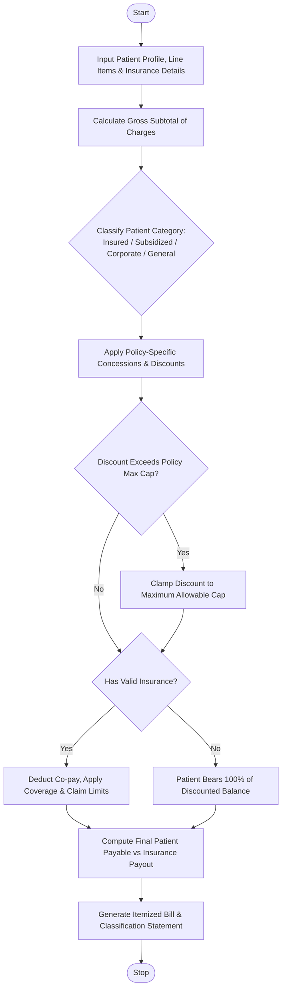

Here is a complete design and implementation for the **Hospital Billing and Patient Classification System**, covering the problem statement, algorithm, Mermaid flowchart, Python source code, and sample I/O.

---

## 1. Problem Statement

Hospital revenue management requires balancing complex medical service charges with patient-specific payment policies, insurance coverage, and conditional concessions (such as senior citizen discounts, charitable subsidies, or corporate tier benefits).

The objective is to design an automated system that:

1. **Aggregates itemized medical charges** including consultations, diagnostics (labs/imaging), treatments/procedures, and room rent.
2. **Classifies patients** into payment categories (e.g., *Insured*, *Subsidized / Indigent*, *Corporate Partner*, *General Private*) based on demographic and policy criteria.
3. **Applies conditional concessions and insurance rules** (deductibles, co-pays, policy maximum limits).
4. **Validates billing constraints** to ensure discounts do not violate policy caps and final balances are mathematically consistent.

---

## 2. Algorithm

1. **Initialize Inputs:** Load patient profile, itemized billing records, insurance policy details, and hospital concession rules.
2. **Calculate Subtotal:** Sum all itemized charges (Consultation + Diagnostics + Treatment + Room Rent).
3. **Determine Patient Classification:** Evaluate patient attributes (income bracket, age, corporate tie-up, insurance status) to assign a payment classification category.
4. **Apply Policy-Driven Concessions & Discounts:**
* Compute applicable institutional discounts based on classification (e.g., 10% senior citizen discount or 50% BPL subsidy).
* Enforce maximum concession caps.


5. **Process Insurance Coverage:**
* Subtract deductible from the discounted subtotal.
* Apply insurance co-insurance/coverage percentage on the remaining eligible amount, respecting any policy claim caps.


6. **Calculate Final Balances:** Determine the hospital-paid subsidy, insurance-paid amount, and out-of-pocket patient payable balance.
7. **Generate Report:** Output the itemized bill statement, patient classification status, and payment breakdown.

---

## 3. Flowchart (Mermaid)



---

## 4. Python Source Code

```python
class HospitalBillingSystem:
    def __init__(self, max_discount_pct=40.0):
        self.max_discount_pct = max_discount_pct

    def classify_patient(self, profile):
        if profile.get("is_indigent") or profile.get("annual_income", 999999) < 20000:
            return "Subsidized (BPL)"
        elif profile.get("corporate_partner"):
            return "Corporate Tier-1"
        elif profile.get("has_insurance"):
            return "Insured Private"
        else:
            return "General Cash"

    def process_bill(self, profile, line_items):
        # 1. Calculate Gross Subtotal
        consultation = sum(line_items.get("consultation", []))
        diagnostics = sum(line_items.get("diagnostics", []))
        treatment = sum(line_items.get("treatment", []))
        room_rent = sum(line_items.get("room_rent", []))
        
        gross_total = consultation + diagnostics + treatment + room_rent

        # 2. Classify Patient
        category = self.classify_patient(profile)

        # 3. Apply Concessions based on Classification
        discount_amount = 0.0
        if category == "Subsidized (BPL)":
            discount_amount = gross_total * 0.50  # 50% subsidy
        elif profile.get("age", 0) >= 60:
            discount_amount = gross_total * 0.10  # 10% senior citizen discount
        elif category == "Corporate Tier-1":
            discount_amount = gross_total * 0.15  # 15% corporate discount

        # Validate against maximum discount cap
        max_allowed_discount = gross_total * (self.max_discount_pct / 100.0)
        if discount_amount > max_allowed_discount:
            discount_amount = max_allowed_discount

        net_after_discount = gross_total - discount_amount

        # 4. Process Insurance / Co-pay
        insurance_payout = 0.0
        patient_payable = net_after_discount

        if profile.get("has_insurance") and category != "Subsidized (BPL)":
            deductible = profile.get("insurance_deductible", 500.0)
            coverage_pct = profile.get("insurance_coverage_pct", 80.0)
            max_claim = profile.get("insurance_max_claim", 10000.0)

            eligible_for_insurance = max(0.0, net_after_discount - deductible)
            calculated_payout = eligible_for_insurance * (coverage_pct / 100.0)
            
            insurance_payout = min(calculated_payout, max_claim)
            patient_payable = net_after_discount - insurance_payout

        return {
            "patient_name": profile.get("name"),
            "classification": category,
            "gross_total": round(gross_total, 2),
            "discount_applied": round(discount_amount, 2),
            "net_after_discount": round(net_after_discount, 2),
            "insurance_payout": round(insurance_payout, 2),
            "patient_payable": round(patient_payable, 2)
        }

# --- Sample Execution ---
if __name__ == "__main__":
    billing_system = HospitalBillingSystem(max_discount_pct=40.0)

    # Sample Patient Profile
    patient = {
        "name": "Eleanor Vance",
        "age": 64,
        "is_indigent": False,
        "corporate_partner": False,
        "has_insurance": True,
        "insurance_deductible": 250.0,
        "insurance_coverage_pct": 85.0,
        "insurance_max_claim": 8000.0
    }

    # Itemized Charges
    charges = {
        "consultation": [150.0, 200.0],
        "diagnostics": [350.0, 120.0],
        "treatment": [2400.0],
        "room_rent": [600.0, 600.0]
    }

    statement = billing_system.process_bill(patient, charges)

    print("=== HOSPITAL BILLING STATEMENT ===")
    print(f"Patient Name: {statement['patient_name']}")
    print(f"Patient Classification: {statement['classification']}")
    print(f"----------------------------------------")
    print(f"Gross Subtotal:     ${statement['gross_total']:.2f}")
    print(f"Concession/Discount: -${statement['discount_applied']:.2f}")
    print(f"Net Amount:         ${statement['net_after_discount']:.2f}")
    print(f"Insurance Payout:   -${statement['insurance_payout']:.2f}")
    print(f"========================================")
    print(f"PATIENT PAYABLE:    ${statement['patient_payable']:.2f}")

```

---

## 5. Sample Input

* **Patient Profile:**
* Name: `Eleanor Vance`
* Age: `64` *(Eligible for Senior Citizen Concession)*
* Income Status: Standard / Non-Indigent
* Insurance Status: Active (`Deductible: $250.00`, `Coverage: 85%`, `Max Claim: $8,000`)


* **Itemized Charges:**
* Consultations: `$150.00`, `$200.00`
* Diagnostics (Labs/X-Ray): `$350.00`, `$120.00`
* Treatments/Procedures: `$2,400.00`
* Room Rent (2 Days): `$600.00` $\times$ `2` = `$1,200.00`
* *Gross Subtotal:* `$4,420.00`


---

## 6. Sample Output

```text
=== HOSPITAL BILLING STATEMENT ===
Patient Name: Eleanor Vance
Patient Classification: Insured Private
----------------------------------------
Gross Subtotal:     $4420.00
Concession/Discount: -$442.00
Net Amount:         $3978.00
Insurance Payout:   -$3168.30
========================================
PATIENT PAYABLE:    $809.70

```

*(Note breakdown: 10% Senior discount on `$4,420` is `$442`, leaving `$3,978`. Deducting `$250` deductible leaves `$3,728`, of which 85% is covered by insurance equals `$3,168.30`. The remaining balance `$809.70` is paid out-of-pocket by the patient).*

---
