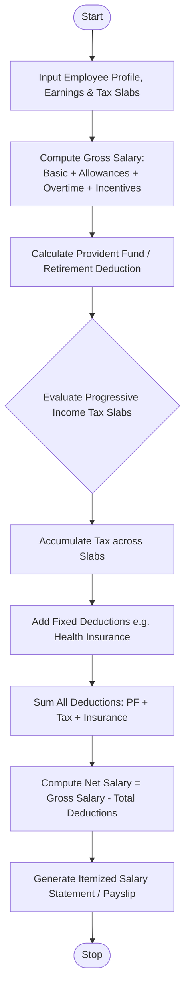

Here is a complete design and implementation for the **Employee Payroll and Deduction Analysis System**, covering the problem statement, algorithm, Mermaid flowchart, Python source code, and sample I/O.

---

## 1. Problem Statement

Accurate payroll management requires combining variable earnings (allowances, overtime, performance bonuses) with statutory and progressive deductions (tiered income tax brackets, provident fund, insurance) to determine an employee's final take-home (net) salary.

The objective is to design an automated payroll system that:

1. **Computes Gross Salary** by aggregating basic pay, fixed allowances, calculated overtime compensation, and performance incentives.
2. **Applies Progressive Deductions** using tiered income tax brackets alongside fixed deductions like provident fund and health insurance.
3. **Calculates Net Salary** and generates a professional, itemized monthly salary statement / payslip.

---

## 2. Algorithm

1. **Initialize Inputs:** Load employee profile, basic pay, allowances dictionary, overtime hours and hourly rate, incentives, provident fund percentage, and progressive tax slabs.
2. **Calculate Gross Earnings:**
* Sum base basic salary and all fixed allowances (e.g., House Rent Allowance, Transport).
* Calculate Overtime Pay (`hours $\times$ hourly rate`).
* Add performance incentives.
* Total these components to establish the **Gross Salary**.


3. **Compute Deductions:**
* **Retirement/Provident Fund:** Calculate percentage-based deduction from basic pay.
* **Progressive Income Tax:** Evaluate taxable income through progressive brackets (e.g., 0% on first tier, 10% on second, 20% on higher tiers).
* **Fixed Deductions:** Add health insurance or union dues.


4. **Calculate Net Salary:** Subtract Total Deductions from Gross Salary (`Net Salary = Gross Salary - Total Deductions`).
5. **Generate Output:** Format and display a detailed itemized payslip breakdown.

---

## 3. Flowchart (Mermaid)



---

## 4. Python Source Code

```python
class PayrollSystem:
    def __init__(self, tax_slabs, pf_rate=0.06, health_insurance=150.0):
        """
        tax_slabs: List of tuples -> (upper_limit, tax_rate_percentage)
                   e.g., [(2000, 0.0), (5000, 0.10), (float('inf'), 0.20)]
        """
        self.tax_slabs = tax_slabs
        self.pf_rate = pf_rate
        self.health_insurance = health_insurance

    def calculate_progressive_tax(self, taxable_income):
        remaining_income = taxable_income
        total_tax = 0.0
        previous_limit = 0

        for limit, rate in self.tax_slabs:
            if remaining_income <= 0:
                break
            
            bracket_capacity = limit - previous_limit
            taxable_in_bracket = min(remaining_income, bracket_capacity)
            
            total_tax += taxable_in_bracket * rate
            remaining_income -= taxable_in_bracket
            previous_limit = limit

        return round(total_tax, 2)

    def process_payroll(self, employee):
        # 1. Gross Earnings Calculation
        basic = employee["basic_pay"]
        allowances_total = sum(employee["allowances"].values())
        overtime_pay = employee.get("overtime_hours", 0) * employee.get("overtime_rate", 0.0)
        incentive = employee.get("incentive", 0.0)

        gross_salary = round(basic + allowances_total + overtime_pay + incentive, 2)

        # 2. Deductions Calculation
        pf_deduction = round(basic * self.pf_rate, 2)
        
        # Taxable income calculation (Gross minus PF or basic deductions)
        taxable_income = gross_salary - pf_deduction
        income_tax = self.calculate_progressive_tax(taxable_income)
        
        total_deductions = round(pf_deduction + income_tax + self.health_insurance, 2)

        # 3. Net Salary Calculation
        net_salary = round(gross_salary - total_deductions, 2)

        return {
            "name": employee["name"],
            "id": employee["id"],
            "basic": basic,
            "allowances_total": allowances_total,
            "overtime_pay": overtime_pay,
            "incentive": incentive,
            "gross_salary": gross_salary,
            "pf_deduction": pf_deduction,
            "income_tax": income_tax,
            "health_insurance": self.health_insurance,
            "total_deductions": total_deductions,
            "net_salary": net_salary
        }

# --- Sample Execution ---
if __name__ == "__main__":
    # Progressive tax slabs: First $2,500 @ 0%, Next $3,500 @ 12%, Balance @ 22%
    tax_slabs = [
        (2500, 0.0),
        (6000, 0.12),
        (float('inf'), 0.22)
    ]

    payroll = PayrollSystem(tax_slabs=tax_slabs, pf_rate=0.08, health_insurance=180.0)

    employee_record = {
        "id": "EMP-4092",
        "name": "Marcus Vance",
        "basic_pay": 4800.0,
        "allowances": {"HRA": 1200.0, "Transport": 400.0, "Meal": 250.0},
        "overtime_hours": 12,
        "overtime_rate": 35.0,
        "incentive": 600.0
    }

    payslip = payroll.process_payroll(employee_record)

    print("========================================")
    print("           MONTHLY PAYSLIP              ")
    print("========================================")
    print(f"Employee Name : {payslip['name']} ({payslip['id']})")
    print("----------------------------------------")
    print(f"Basic Pay     : ${payslip['basic']:.2f}")
    print(f"Allowances    : ${payslip['allowances_total']:.2f}")
    print(f"Overtime Pay  : ${payslip['overtime_pay']:.2f}")
    print(f"Incentives    : ${payslip['incentive']:.2f}")
    print(f"----------------------------------------")
    print(f"GROSS SALARY  : ${payslip['gross_salary']:.2f}")
    print("----------------------------------------")
    print(f"Provident Fund: ${payslip['pf_deduction']:.2f}")
    print(f"Income Tax    : ${payslip['income_tax']:.2f}")
    print(f"Health Insur. : ${payslip['health_insurance']:.2f}")
    print(f"TOTAL DEDUCT. : ${payslip['total_deductions']:.2f}")
    print("========================================")
    print(f"NET TAKE-HOME : ${payslip['net_salary']:.2f}")
    print("========================================")

```

---

## 5. Sample Input

* **Employee Details:**
* ID: `EMP-4092`, Name: `Marcus Vance`
* Basic Pay: `$4,800.00`
* Fixed Allowances: House Rent Allowance (`$1,200.00`), Transport (`$400.00`), Meal (`$250.00`)
* Overtime: `12 hours` at `$35.00` per hour
* Performance Incentive: `$600.00`


* **Company Deduction Rules:**
* Provident Fund (PF): `8.0%` of Basic Pay
* Health Insurance: Fixed `$180.00`
* Progressive Income Tax Slabs:
* Tier 1 (0 – `$2,500`): `0%`
* Tier 2 (`$2,501` – `$6,000`): `12%`
* Tier 3 (Above `$6,000`): `22%`


---

## 6. Sample Output

```text
========================================
           MONTHLY PAYSLIP              
========================================
Employee Name : Marcus Vance (EMP-4092)
----------------------------------------
Basic Pay     : $4800.00
Allowances    : $1850.00
Overtime Pay  : $420.00
Incentives    : $600.00
----------------------------------------
GROSS SALARY  : $7670.00
----------------------------------------
Provident Fund: $384.00
Income Tax    : $606.24
Health Insur. : $180.00
TOTAL DEDUCT. : $1170.24
========================================
NET TAKE-HOME : $6499.76
========================================

```

---
