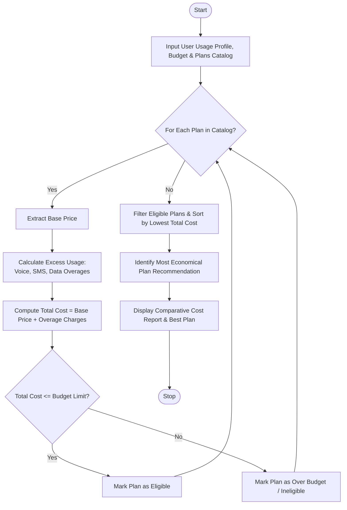

Here is a complete design and implementation for the **Multi-Plan Telecommunications Cost Optimization System**, covering the problem statement, algorithm, Mermaid flowchart, Python source code, and sample I/O.

---

## 1. Problem Statement

Choosing the right mobile plan can be complex due to varying base monthly fees, included allowances (voice minutes, SMS, and data), and hidden overage charges when limits are exceeded.

The objective is to design an automated optimization system that:

1. **Evaluates multiple telecommunication plans** against a user's specific monthly usage profile.
2. **Calculates excess charges** (overages) whenever usage exceeds plan allowances for voice, text, or data.
3. **Applies budget constraints** to filter out unaffordable options.
4. **Identifies and recommends the most economical eligible plan** that minimizes the total monthly expenditure.

---

## 2. Algorithm

1. **Initialize Inputs:** Load user usage metrics (voice minutes, SMS count, data in GB) and maximum budget limit, alongside a catalog of available telecom plans with their allowances and overage rates.
2. **Evaluate Each Plan:**
* Extract the **Base Price** of the plan.
* Calculate excess usage (`max(0, user_usage - allowance)` ) for voice, SMS, and data.
* Compute overage costs by multiplying excess usage by the respective overage rates.
* Sum base price and total overage charges to determine the **Total Estimated Cost**.


3. **Filter and Validate:** Check if the total cost is less than or equal to the user's **Budget Limit**. Mark as eligible or ineligible.
4. **Rank Options:** Sort all eligible plans by total cost in ascending order.
5. **Select Optimal Plan:** Identify the top-ranked plan as the most economical recommendation and output the comparative evaluation report.

---

## 3. Flowchart (Mermaid)



---

## 4. Python Source Code

```python
class TelecomOptimizer:
    def __init__(self, user_usage, budget_limit):
        """
        user_usage: Dict containing 'voice' (mins), 'sms' (count), 'data' (GB)
        budget_limit: Maximum allowed monthly expenditure
        """
        self.user_usage = user_usage
        self.budget_limit = budget_limit

    def evaluate_plans(self, plans):
        results = []
        for plan in plans:
            base_cost = plan["base_price"]
            
            # 1. Calculate Overage (Excess Usage)
            voice_overage = max(0, self.user_usage["voice"] - plan["allowances"]["voice"])
            sms_overage = max(0, self.user_usage["sms"] - plan["allowances"]["sms"])
            data_overage = max(0, self.user_usage["data"] - plan["allowances"]["data"])
            
            # 2. Calculate Overage Costs
            voice_cost = voice_overage * plan["overage_rates"]["voice"]
            sms_cost = sms_overage * plan["overage_rates"]["sms"]
            data_cost = data_overage * plan["overage_rates"]["data"]
            
            overage_total = round(voice_cost + sms_cost + data_cost, 2)
            total_cost = round(base_cost + overage_total, 2)
            
            # 3. Check Budget Constraint
            is_eligible = total_cost <= self.budget_limit
            
            results.append({
                "plan_name": plan["name"],
                "base_price": base_cost,
                "overage_total": overage_total,
                "total_cost": total_cost,
                "is_eligible": is_eligible
            })
        
        # Filter eligible plans and sort by total cost (ascending)
        eligible_plans = [p for p in results if p["is_eligible"]]
        eligible_plans.sort(key=lambda x: x["total_cost"])
        
        best_plan = eligible_plans[0] if eligible_plans else None
        return results, best_plan

# --- Sample Execution ---
if __name__ == "__main__":
    # User's Monthly Projected Usage
    my_usage = {
        "voice": 450,  # minutes
        "sms": 120,    # texts
        "data": 18.5   # GB
    }
    monthly_budget = 65.00

    # Available Telecom Plans Catalog
    telecom_plans = [
        {
            "name": "Budget Saver Plan",
            "base_price": 30.00,
            "allowances": {"voice": 300, "sms": 100, "data": 10.0},
            "overage_rates": {"voice": 0.15, "sms": 0.05, "data": 5.00} # data per GB over
        },
        {
            "name": "Standard Flex Plan",
            "base_price": 45.00,
            "allowances": {"voice": 500, "sms": 200, "data": 15.0},
            "overage_rates": {"voice": 0.10, "sms": 0.03, "data": 4.00}
        },
        {
            "name": "Unlimited Pro Plan",
            "base_price": 70.00, # Exceeds budget limit of $65
            "allowances": {"voice": 1000, "sms": 500, "data": 40.0},
            "overage_rates": {"voice": 0.00, "sms": 0.00, "data": 0.00}
        },
        {
            "name": "Data Heavy Plan",
            "base_price": 50.00,
            "allowances": {"voice": 400, "sms": 50, "data": 25.0},
            "overage_rates": {"voice": 0.12, "sms": 0.05, "data": 3.50}
        }
    ]

    optimizer = TelecomOptimizer(user_usage=my_usage, budget_limit=monthly_budget)
    evaluation_results, optimal_plan = optimizer.evaluate_plans(telecom_plans)

    print("==================================================")
    print("          TELECOM PLAN EVALUATION REPORT          ")
    print("==================================================")
    for res in evaluation_results:
        status = "ELIGIBLE" if res["is_eligible"] else "OVER BUDGET / INELIGIBLE"
        print(f"Plan: {res['plan_name']}")
        print(f"  Base Price    : ${res['base_price']:.2f}")
        print(f"  Overage Charges: ${res['overage_total']:.2f}")
        print(f"  Total Cost    : ${res['total_cost']:.2f} [{status}]")
        print("-" * 50)

    print("\n==================================================")
    if optimal_plan:
        print(f"🏆 RECOMMENDED OPTIMAL PLAN: {optimal_plan['plan_name']}")
        print(f"   Total Estimated Monthly Cost: ${optimal_plan['total_cost']:.2f}")
    else:
        print("❌ No plans found within your specified budget limit.")
    print("==================================================")

```

---

## 5. Sample Input

* **User Usage Profile:**
* Voice Minutes: `450 mins`
* Text Messages: `120 SMS`
* Data Consumption: `18.5 GB`


* **Budget Limit:** `$65.00`
* **Plan Catalog:**
1. *Budget Saver Plan* ($30.00 base, 300 mins, 100 SMS, 10 GB)
2. *Standard Flex Plan* ($45.00 base, 500 mins, 200 SMS, 15 GB)
3. *Unlimited Pro Plan* ($70.00 base, 1000 mins, 500 SMS, 40 GB)
4. *Data Heavy Plan* ($50.00 base, 400 mins, 50 SMS, 25 GB)


---

## 6. Sample Output

```text
==================================================
          TELECOM PLAN EVALUATION REPORT          
==================================================
Plan: Budget Saver Plan
  Base Price    : $30.00
  Overage Charges: $65.50
  Total Cost    : $95.50 [OVER BUDGET / INELIGIBLE]
--------------------------------------------------
Plan: Standard Flex Plan
  Base Price    : $45.00
  Overage Charges: $17.00
  Total Cost    : $62.00 [ELIGIBLE]
--------------------------------------------------
Plan: Unlimited Pro Plan
  Base Price    : $70.00
  Overage Charges: $0.00
  Total Cost    : $70.00 [OVER BUDGET / INELIGIBLE]
--------------------------------------------------
Plan: Data Heavy Plan
  Base Price    : $50.00
  Overage Charges: $6.60
  Total Cost    : $56.60 [ELIGIBLE]
--------------------------------------------------

==================================================
🏆 RECOMMENDED OPTIMAL PLAN: Data Heavy Plan
   Total Estimated Monthly Cost: $56.60
==================================================

```

*(Note: While Standard Flex Plan is eligible at `$62.00`, the **Data Heavy Plan** turns out to be more economical at `$56.60` because its higher data allowance minimizes expensive overage charges).*
