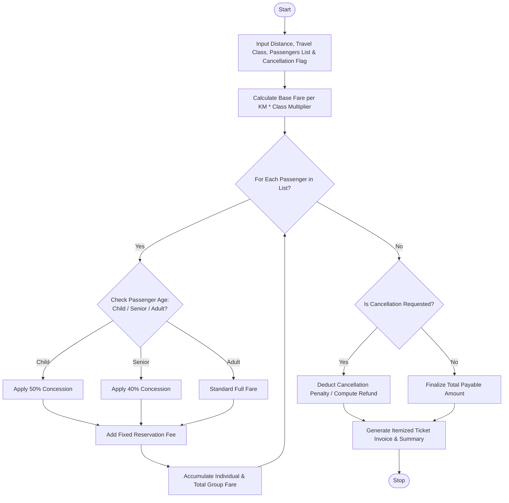

Here is a complete design and implementation for the **Railway Fare and Reservation Calculator**, covering the problem statement, algorithm, Mermaid flowchart, Python source code, and sample I/O.

---

## 1. Problem Statement

Railway ticketing requires complex fare determinations based on distance traveled, travel classes (e.g., Sleeper, AC 3-Tier, AC 2-Tier), fixed reservation surcharges, passenger demographics (age-based concessions for children and senior citizens), and cancellation penalty rules.

The objective is to design an automated system that:

1. **Computes Distance-Based Slabs & Class Fares** using variable per-kilometer rates multiplied by class-specific coefficients.
2. **Applies Age-Based Concessions** (e.g., child discounts, senior citizen subsidies).
3. **Adds Fixed Reservation and Ancillary Fees** per passenger.
4. **Calculates Cancellation Penalties & Refunds** if a ticket cancellation is requested.
5. **Generates a Detailed Passenger Group Invoice** outlining individual and total ticket costs.

---

## 2. Algorithm

1. **Initialize Inputs:** Load distance (in km), travel class type, reservation fees, and passenger demographic details (name, age, gender).
2. **Calculate Base Fare:**
* Compute base rate using distance slabs or a standard per-km rate.
* Multiply by the selected travel class multiplier (e.g., Sleeper = 1.0, AC 3-Tier = 2.2, AC 1st = 4.0).


3. **Process Passenger-Specific Adjustments:**
* For each passenger, check age criteria:
* Children (Age < 12): Apply 50% concession.
* Senior Citizens (Age $\ge$ 60): Apply 40% concession.
* Adults (12–59): Full fare.


* Add fixed reservation/booking fees.


4. **Handle Cancellation (Optional):** If cancellation is flagged, compute penalty deductions based on cancellation tier windows and output the net refund amount.
5. **Generate Output:** Present an itemized breakdown for each passenger and the cumulative group total.

---

## 3. Flowchart (Mermaid)



---

## 4. Python Source Code

```python
class RailwayFareCalculator:
    def __init__(self, class_multipliers, base_rate_per_km=1.25, reservation_fee=30.0):
        """
        class_multipliers: Dict of class names to multiplier factors (e.g., {"SL": 1.0, "3AC": 2.2, "1AC": 4.0})
        base_rate_per_km: Base charge per kilometer
        reservation_fee: Flat booking fee per passenger
        """
        self.class_multipliers = class_multipliers
        self.base_rate_per_km = base_rate_per_km
        self.reservation_fee = reservation_fee

    def calculate_passenger_fare(self, distance, travel_class, passenger):
        multiplier = self.class_multipliers.get(travel_class, 1.0)
        base_fare = distance * self.base_rate_per_km * multiplier

        # Age-based concessions
        age = passenger["age"]
        concession_desc = "None (Standard Adult)"
        discount_multiplier = 1.0

        if age < 5:
            # Toddlers travel free without berth
            discount_multiplier = 0.0
            concession_desc = "Infant (100% Concession)"
        elif age < 12:
            discount_multiplier = 0.50
            concession_desc = "Child (50% Concession)"
        elif age >= 60:
            discount_multiplier = 0.60  # 40% off
            concession_desc = "Senior Citizen (40% Concession)"

        net_fare = (base_fare * discount_multiplier) + self.reservation_fee

        return {
            "name": passenger["name"],
            "age": age,
            "base_fare": round(base_fare, 2),
            "concession": concession_desc,
            "fare_after_concession": round(base_fare * discount_multiplier, 2),
            "reservation_fee": self.reservation_fee,
            "total_passenger_fare": round(net_fare, 2)
        }

    def process_booking(self, distance, travel_class, passengers, is_cancelled=False, cancellation_penalty_pct=15.0):
        if travel_class not in self.class_multipliers:
            raise ValueError(f"Invalid travel class: {travel_class}")

        itemized_passengers = []
        total_gross_fare = 0.0

        for p in passengers:
            p_details = self.calculate_passenger_fare(distance, travel_class, p)
            itemized_passengers.append(p_details)
            total_gross_fare += p_details["total_passenger_fare"]

        total_gross_fare = round(total_gross_fare, 2)
        refund_amount = 0.0
        net_payable = total_gross_fare

        if is_cancelled:
            penalty_amount = round(total_gross_fare * (cancellation_penalty_pct / 100.0), 2)
            refund_amount = round(total_gross_fare - penalty_amount, 2)
            net_payable = 0.0

        return {
            "distance": distance,
            "travel_class": travel_class,
            "passengers": itemized_passengers,
            "total_gross_fare": total_gross_fare,
            "is_cancelled": is_cancelled,
            "cancellation_penalty": round(total_gross_fare * (cancellation_penalty_pct / 100.0), 2) if is_cancelled else 0.0,
            "refund_amount": refund_amount,
            "net_payable": net_payable
        }

# --- Sample Execution ---
if __name__ == "__main__":
    # Class Multipliers
    multipliers = {
        "SL": 1.0,    # Sleeper
        "3AC": 2.4,   # AC 3-Tier
        "2AC": 3.2,   # AC 2-Tier
        "1AC": 4.5    # First AC
    }

    calculator = RailwayFareCalculator(
        class_multipliers=multipliers,
        base_rate_per_km=1.10,
        reservation_fee=40.0
    )

    # Sample Group Passengers
    group_passengers = [
        {"name": "Arthur Pendelton", "age": 65},  # Senior Citizen
        {"name": "Guinevere Pendelton", "age": 62}, # Senior Citizen
        {"name": "Lancelot Pendelton", "age": 34},  # Adult
        {"name": "Mordred Pendelton", "age": 8}     # Child
    ]

    # Booking parameters: 850 km journey in AC 3-Tier ("3AC")
    booking_result = calculator.process_booking(
        distance=850,
        travel_class="3AC",
        passengers=group_passengers,
        is_cancelled=False
    )

    print("==================================================")
    print("            RAILWAY TICKET INVOICE                ")
    print("==================================================")
    print(f"Travel Distance : {booking_result['distance']} km")
    print(f"Travel Class    : {booking_result['travel_class']}")
    print("--------------------------------------------------")
    for p in booking_result['passengers']:
        print(f"Passenger: {p['name']} (Age: {p['age']})")
        print(f"  Concession Applied: {p['concession']}")
        print(f"  Base Fare Share   : ${p['fare_after_concession']:.2f}")
        print(f"  Reservation Fee   : ${p['reservation_fee']:.2f}")
        print(f"  Subtotal          : ${p['total_passenger_fare']:.2f}")
        print("-" * 50)

    print(f"==================================================")
    print(f"TOTAL GROSS FARE    : ${booking_result['total_gross_fare']:.2f}")
    if booking_result['is_cancelled']:
        print(f"Cancellation Penalty: ${booking_result['cancellation_penalty']:.2f}")
        print(f"REFUNDABLE AMOUNT   : ${booking_result['refund_amount']:.2f}")
    else:
        print(f"NET AMOUNT PAYABLE  : ${booking_result['net_payable']:.2f}")
    print("==================================================")

```

---

## 5. Sample Input

* **Journey Distance:** `850 km`
* **Travel Class:** `3AC` (AC 3-Tier Multiplier = `2.4`)
* **Base Rate:** `$1.10` per km
* **Reservation Fee:** `$40.00` per passenger
* **Passenger Manifest:**
1. *Arthur Pendelton* (`Age: 65` $\rightarrow$ Senior Citizen 40% concession)
2. *Guinevere Pendelton* (`Age: 62` $\rightarrow$ Senior Citizen 40% concession)
3. *Lancelot Pendelton* (`Age: 34` $\rightarrow$ Adult full fare)
4. *Mordred Pendelton* (`Age: 8` $\rightarrow$ Child 50% concession)


* **Cancellation Status:** `False` (Active Booking)

---

## 6. Sample Output

```text
==================================================
            RAILWAY TICKET INVOICE                
==================================================
Travel Distance : 850 km
Travel Class    : 3AC
--------------------------------------------------
Passenger: Arthur Pendelton (Age: 65)
  Concession Applied: Senior Citizen (40% Concession)
  Base Fare Share   : $1346.40
  Reservation Fee   : $40.00
  Subtotal          : $1386.40
--------------------------------------------------
Passenger: Guinevere Pendelton (Age: 62)
  Concession Applied: Senior Citizen (40% Concession)
  Base Fare Share   : $1346.40
  Reservation Fee   : $40.00
  Subtotal          : $1386.40
--------------------------------------------------
Passenger: Lancelot Pendelton (Age: 34)
  Concession Applied: None (Standard Adult)
  Base Fare Share   : $2244.00
  Reservation Fee   : $40.00
  Subtotal          : $2284.00
--------------------------------------------------
Passenger: Mordred Pendelton (Age: 8)
  Concession Applied: Child (50% Concession)
  Base Fare Share   : $1122.00
  Reservation Fee   : $40.00
  Subtotal          : $1162.00
--------------------------------------------------
==================================================
TOTAL GROSS FARE    : $6218.80
NET AMOUNT PAYABLE  : $6218.80
==================================================

```
